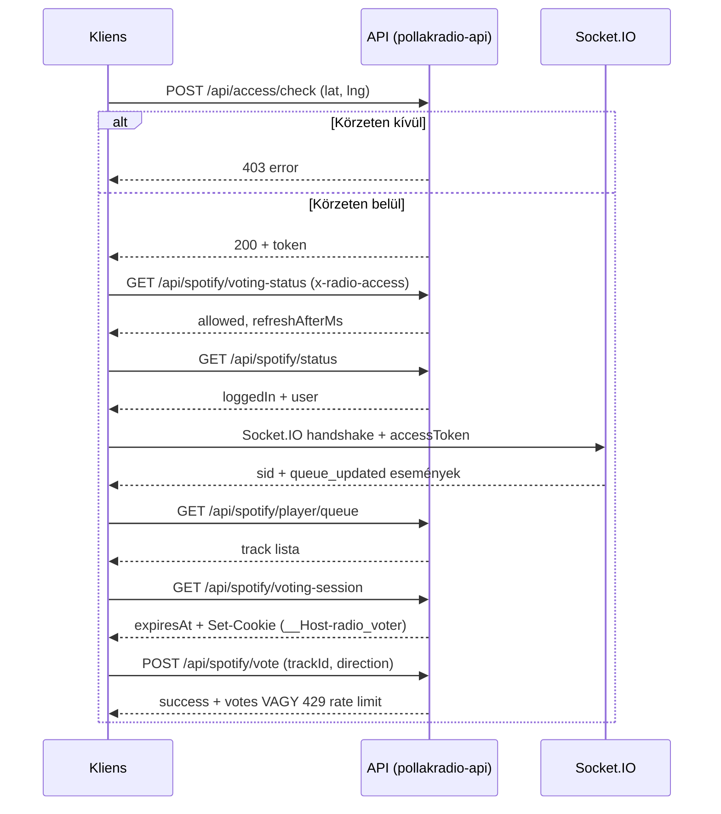

# PollakRadio API Dokumentáció


> **Fontos biztonsági megjegyzés:** A dokumentációban szereplő tokenek, cookie-k és személyes adatok placeholder értékekre vannak cserélve (`YOUR_RADIO_ACCESS_TOKEN`, `YOUR_VOTER_COOKIE` stb.). A valódi rögzített értékeket soha ne használd újra.

---

## Tartalomjegyzék

1. [Áttekintés](#1-áttekintés)
2. [Összesített endpointlista](#2-összesített-endpointlista)
3. [Hitelesítés és sessionkezelés](#3-hitelesítés-és-sessionkezelés)
4. [Endpointok részletes dokumentációja](#4-endpointok-részletes-dokumentációja)
   - [4.1 POST /api/access/check](#41-post-apiaccesscheck)
   - [4.2 GET /api/spotify/voting-status](#42-get-apispotifyvoting-status)
   - [4.3 GET /api/spotify/status](#43-get-apispotifystatus)
   - [4.4 GET /api/spotify/voting-session](#44-get-apispotifyvoting-session)
   - [4.5 GET /api/spotify/player/queue](#45-get-apispotifyplayerqueue)
   - [4.6 GET /api/spotify/player/current](#46-get-apispotifyplayercurrent)
   - [4.7 POST /api/spotify/vote](#47-post-apispotifyvote)
   - [4.8 OPTIONS preflight kérések](#48-options-preflight-kérések)
5. [WebSocket / Socket.IO dokumentáció](#5-websocket--socketio-dokumentáció)
6. [API-funkciók és kapcsolatok](#6-api-funkciók-és-kapcsolatok)
7. [Hibakódok és hibakezelés](#7-hibakódok-és-hibakezelés)
8. [Összesítés és statisztikák](#8-összesítés-és-statisztikák)

---

## 1. Áttekintés

A **PollakRadio** egy iskolai rádiófelület (Pollák Mihály Technikum), amely Spotify integrációt használ. A rendszer földrajzi korlátozást alkalmaz: a rádió felülete csak az iskola körzetében érhető el.

### Fő komponensek

| Komponens | URL / Host | Szerep |
|-----------|------------|--------|
| Frontend | `https://pollakradio.pollak.info` | Statikus webalkalmazás |
| Backend API | `https://pollakradio-api.pollak.info` | Express.js alapú REST API + Socket.IO |
| Spotify | Külső | Lejátszó és felhasználói adatok |

### Technológiai megfigyelések (a forgalom alapján)

- Backend: **Express.js** (`x-powered-by: Express`)
- CDN / Proxy: **Cloudflare**
- Valós idejű kommunikáció: **Socket.IO v4** (Engine.IO 4)
- CORS: `Access-Control-Allow-Origin: *` (nyílt)
- Fő hitelesítési header: `x-radio-access`
- Szavazó cookie: `__Host-radio_voter` (HttpOnly, Secure, SameSite=Strict)

---

## 2. Összesített endpointlista

| # | Metódus | Endpoint | Funkció | Auth szükséges |
|---|---------|----------|---------|----------------|
| 1 | POST | `/api/access/check` | Helymeghatározás alapú hozzáférés-ellenőrzés, token kiadás | Nem |
| 2 | GET | `/api/spotify/voting-status` | Szavazási jogosultság és frissítési idő | Igen (`x-radio-access`) |
| 3 | GET | `/api/spotify/status` | Spotify bejelentkezési állapot és felhasználói adatok | Igen (`x-radio-access`) |
| 4 | GET | `/api/spotify/voting-session` | Szavazási session indítása / cookie kiadása | Igen (`x-radio-access`) |
| 5 | GET | `/api/spotify/player/queue` | Aktuális lejátszási sor lekérése | Igen (`x-radio-access`) |
| 6 | GET | `/api/spotify/player/current` | Jelenleg játszott szám | Igen (`x-radio-access`) |
| 7 | POST | `/api/spotify/vote` | Szavazat leadása egy trackre | Igen (`x-radio-access` + cookie) |
| 8 | GET/POST | `/socket.io/` | Socket.IO handshake és polling | Részben (accessToken a body-ban) |
| 9 | GET | `/socket.io/` (websocket) | WebSocket upgrade | Igen (sid) |

### Funkciók szerinti csoportosítás

**Hozzáférés-kezelés**
- `POST /api/access/check`

**Szavazás**
- `GET /api/spotify/voting-status`
- `GET /api/spotify/voting-session`
- `POST /api/spotify/vote`

**Lejátszó / Queue**
- `GET /api/spotify/player/queue`
- `GET /api/spotify/player/current`
- `GET /api/spotify/status`

**Valós idejű**
- Socket.IO (`/socket.io/`) + `queue_updated` esemény

---

## 3. Hitelesítés és sessionkezelés

### 3.1 Hozzáférési token (`x-radio-access`)

A rendszer **nem** klasszikus Bearer tokenes OAuth-ot használ a kliens oldalon. Helyette egy saját token mechanizmust alkalmaz.

1. A kliens elküldi a GPS koordinátákat a `POST /api/access/check` endpointnak.
2. Ha a pozíció az iskola körzetében van, a szerver visszaad egy tokent.
3. A token a `x-radio-access` HTTP headerben utazik a további kéréseknél.

**Token formátum (példa – placeholder):**
```
YOUR_RADIO_ACCESS_TOKEN
```
A token két részből áll (`.`-tal elválasztva): egy base64-szerű payload (JSON: `expiresAt`, `revision`) + aláírás.

**Lejárat:** A `expiresAt` mező milliszekundumban van megadva (Unix epoch * 1000). A rögzített példában hosszú lejáratú (több év).

### 3.2 Szavazó cookie (`__Host-radio_voter`)

A `GET /api/spotify/voting-session` hívás után a szerver beállít egy cookie-t:

```
Set-Cookie: __Host-radio_voter=YOUR_VOTER_COOKIE; Max-Age=86400; Path=/; HttpOnly; Secure; SameSite=Strict
```

Ez a cookie a `POST /api/spotify/vote` kéréseknél kötelezőnek tűnik (a rögzített forgalomban mindig jelen volt sikeres szavazáskor).

### 3.3 Socket.IO autentikáció

A Socket.IO kapcsolatnál a kliens a polling POST body-ban küldi az `accessToken` mezőt:

```
40{"accessToken":"YOUR_RADIO_ACCESS_TOKEN"}
```

### 3.4 Nincs megfigyelt

- Authorization: Bearer header
- Klasszikus session cookie (kivéve a voter cookie)
- CSRF token
- Explicit logout endpoint

### 3.5 Python session példa

```python
import os
import requests

BASE_URL = "https://pollakradio-api.pollak.info"

# Környezeti változókból olvasás (ajánlott)
RADIO_TOKEN = os.getenv("RADIO_ACCESS_TOKEN", "YOUR_RADIO_ACCESS_TOKEN")
VOTER_COOKIE = os.getenv("RADIO_VOTER_COOKIE", "YOUR_VOTER_COOKIE")

session = requests.Session()
session.headers.update({
    "Origin": "https://pollakradio.pollak.info",
    "Referer": "https://pollakradio.pollak.info/",
    "Accept": "*/*",
    "User-Agent": "Mozilla/5.0 (compatible; PollakRadioAPIClient/1.0)",
})

def check_access(latitude: float, longitude: float, accuracy: float = 10.0):
    """Hozzáférés ellenőrzése és token lekérése."""
    url = f"{BASE_URL}/api/access/check"
    payload = {
        "latitude": latitude,
        "longitude": longitude,
        "accuracy": accuracy,
    }
    resp = session.post(url, json=payload, timeout=30)
    print("Status:", resp.status_code)
    data = resp.json()
    if resp.status_code == 200 and data.get("allowed"):
        token = data["token"]
        session.headers["x-radio-access"] = token
        print("Token beállítva.")
        return token
    else:
        print("Hozzáférés megtagadva:", data.get("error"))
        return None

def set_voter_cookie(cookie_value: str):
    """Szavazó cookie beállítása a session-ben."""
    session.cookies.set(
        "__Host-radio_voter",
        cookie_value,
        domain="pollakradio-api.pollak.info",
        path="/",
        secure=True,
    )

if __name__ == "__main__":
    # Példa: Szeged környéki koordináták (a forgalomban sikeres volt)
    token = check_access(46.6542, 20.2660, accuracy=8)
    if token:
        # További hívások a session-nel automatikusan tartalmazzák a headert
        r = session.get(f"{BASE_URL}/api/spotify/voting-status", timeout=30)
        print(r.status_code, r.json())
```

---

## 4. Endpointok részletes dokumentációja

### 4.1 POST /api/access/check

**Alapadatok**

| Mező | Érték |
|------|-------|
| Teljes URL | `https://pollakradio-api.pollak.info/api/access/check` |
| HTTP metódus | `POST` |
| Path | `/api/access/check` |
| Host | `pollakradio-api.pollak.info` |
| Content-Type | `application/json` |
| Megfigyelt státuszkódok | `200`, `403` |
| Feltételezett cél | GPS pozíció alapján ellenőrzi, hogy a kliens az iskola körzetében van-e. Sikeres esetén hozzáférési tokent ad. |

**Paraméterek (JSON body)**

| Név | Típus | Kötelező | Példa | Funkció |
|-----|-------|----------|-------|---------|
| `latitude` | number | Igen | `46.65420628318028` | Földrajzi szélesség |
| `longitude` | number | Igen | `20.265974442235784` | Földrajzi hosszúság |
| `accuracy` | number | Igen | `8` | GPS pontosság méterben |

**Request példa**

```http
POST /api/access/check HTTP/2
Host: pollakradio-api.pollak.info
Content-Type: application/json
Origin: https://pollakradio.pollak.info
Referer: https://pollakradio.pollak.info/
Content-Length: 72

{"latitude":46.65420628318028,"longitude":20.265974442235784,"accuracy":8}
```

**Sikeres válasz (200)**

```json
{
  "allowed": true,
  "token": "YOUR_RADIO_ACCESS_TOKEN",
  "expiresAt": 1795452574336
}
```

**Sikertelen válasz (403)**

```json
{
  "error": "A rádió felülete csak az iskola körzetében érhető el."
}
```

**Python példa**

```python
import requests

BASE_URL = "https://pollakradio-api.pollak.info"

def access_check(latitude: float, longitude: float, accuracy: float = 10.0):
    url = f"{BASE_URL}/api/access/check"
    headers = {
        "Content-Type": "application/json",
        "Origin": "https://pollakradio.pollak.info",
        "Referer": "https://pollakradio.pollak.info/",
        "Accept": "*/*",
    }
    payload = {
        "latitude": latitude,
        "longitude": longitude,
        "accuracy": accuracy,
    }
    response = requests.post(url, json=payload, headers=headers, timeout=30)
    print("Status:", response.status_code)
    try:
        data = response.json()
        print(data)
        if response.status_code == 200 and data.get("allowed"):
            return data.get("token")
    except ValueError:
        print(response.text)
    return None

if __name__ == "__main__":
    # Budapest koordináták → várhatóan 403
    access_check(47.5, 19.0412, 1)
    # Sikeres példa (a rögzített forgalomból)
    token = access_check(46.6542, 20.2660, 8)
    print("Kapott token:", token[:50] + "..." if token else None)
```

---

### 4.2 GET /api/spotify/voting-status

**Alapadatok**

| Mező | Érték |
|------|-------|
| Teljes URL | `https://pollakradio-api.pollak.info/api/spotify/voting-status` |
| HTTP metódus | `GET` |
| Path | `/api/spotify/voting-status` |
| Content-Type (válasz) | `application/json; charset=utf-8` |
| Megfigyelt státuszkódok | `200` |
| Feltételezett cél | Ellenőrzi, hogy a kliens jelenleg szavazhat-e, és mikor kell újra lekérdezni. |

**Header paraméterek**

| Név | Típus | Kötelező | Példa | Funkció |
|-----|-------|----------|-------|---------|
| `x-radio-access` | string | Igen | `YOUR_RADIO_ACCESS_TOKEN` | Hozzáférési token |

**Request példa**

```http
GET /api/spotify/voting-status HTTP/2
Host: pollakradio-api.pollak.info
x-radio-access: YOUR_RADIO_ACCESS_TOKEN
Origin: https://pollakradio.pollak.info
Referer: https://pollakradio.pollak.info/
Accept: */*
```

**Sikeres válasz (200)**

```json
{
  "allowed": true,
  "refreshAfterMs": 23904586,
  "announcement": null
}
```

| Mező | Típus | Leírás |
|------|-------|--------|
| `allowed` | boolean | Szavazás engedélyezett-e |
| `refreshAfterMs` | number | Ajánlott újra-lekérdezési idő milliszekundumban |
| `announcement` | string \| null | Esetleges hirdetés / üzenet |

**Python példa**

```python
import os
import requests

BASE_URL = "https://pollakradio-api.pollak.info"
TOKEN = os.getenv("RADIO_ACCESS_TOKEN", "YOUR_RADIO_ACCESS_TOKEN")

def get_voting_status():
    url = f"{BASE_URL}/api/spotify/voting-status"
    headers = {
        "x-radio-access": TOKEN,
        "Origin": "https://pollakradio.pollak.info",
        "Referer": "https://pollakradio.pollak.info/",
        "Accept": "*/*",
    }
    response = requests.get(url, headers=headers, timeout=30)
    print("Status:", response.status_code)
    try:
        data = response.json()
        print(data)
        return data
    except ValueError:
        print(response.text)
        return None

if __name__ == "__main__":
    get_voting_status()
```

---

### 4.3 GET /api/spotify/status

**Alapadatok**

| Mező | Érték |
|------|-------|
| Teljes URL | `https://pollakradio-api.pollak.info/api/spotify/status` |
| HTTP metódus | `GET` |
| Path | `/api/spotify/status` |
| Content-Type (válasz) | `application/json; charset=utf-8` |
| Megfigyelt státuszkódok | `200` |
| Feltételezett cél | A backend Spotify fiókjának bejelentkezési állapotát és alapvető felhasználói adatait adja vissza. |

**Header paraméterek**

| Név | Típus | Kötelező | Példa |
|-----|-------|----------|-------|
| `x-radio-access` | string | Igen | `YOUR_RADIO_ACCESS_TOKEN` |

**Sikeres válasz (200) – anonimizált**

```json
{
  "loggedIn": true,
  "user": {
    "account_id": "XXXXXXX",
    "country": "HU",
    "display_name": "PollakMusic",
    "email": "user@example.com",
    "explicit_content": {
      "filter_enabled": false,
      "filter_locked": false
    },
    "external_urls": {
      "spotify": "https://open.spotify.com/user/XXXXXXXX"
    },
    "followers": {
      "href": null,
      "total": 0
    },
    "href": "https://api.spotify.com/v1/users/XXXXXXXX",
    "id": "XXXXXXXX",
    "images": [],
    "product": "premium",
    "type": "user",
    "uri": "spotify:user:XXXXXXXX"
  }
}
```

**Python példa**

```python
import os
import requests

BASE_URL = "https://pollakradio-api.pollak.info"
TOKEN = os.getenv("RADIO_ACCESS_TOKEN", "YOUR_RADIO_ACCESS_TOKEN")

def get_spotify_status():
    url = f"{BASE_URL}/api/spotify/status"
    headers = {
        "x-radio-access": TOKEN,
        "Origin": "https://pollakradio.pollak.info",
        "Accept": "*/*",
    }
    response = requests.get(url, headers=headers, timeout=30)
    print("Status:", response.status_code)
    try:
        data = response.json()
        # Érzékeny mezők maszkolása kiíráskor
        if "user" in data and "email" in data["user"]:
            data["user"]["email"] = "***@***.***"
        print(data)
        return data
    except ValueError:
        print(response.text)
        return None

if __name__ == "__main__":
    get_spotify_status()
```

---

### 4.4 GET /api/spotify/voting-session

**Alapadatok**

| Mező | Érték |
|------|-------|
| Teljes URL | `https://pollakradio-api.pollak.info/api/spotify/voting-session` |
| HTTP metódus | `GET` |
| Path | `/api/spotify/voting-session` |
| Megfigyelt státuszkódok | `200` |
| Feltételezett cél | Szavazási session létrehozása. Beállítja a `__Host-radio_voter` cookie-t, és visszaadja a session időbélyegeit. |

**Header paraméterek**

| Név | Típus | Kötelező |
|-----|-------|----------|
| `x-radio-access` | string | Igen |

**Sikeres válasz (200)**

```json
{
  "expiresAt": "2026-11-24T16:19:34.865Z",
  "voteReadyAt": "2026-11-23T16:21:04.865Z"
}
```

**Response header (fontos)**

```
Set-Cookie: __Host-radio_voter=YOUR_VOTER_COOKIE; Max-Age=86400; Path=/; HttpOnly; Secure; SameSite=Strict
```

**Python példa**

```python
import os
import requests

BASE_URL = "https://pollakradio-api.pollak.info"
TOKEN = os.getenv("RADIO_ACCESS_TOKEN", "YOUR_RADIO_ACCESS_TOKEN")

def start_voting_session():
    url = f"{BASE_URL}/api/spotify/voting-session"
    headers = {
        "x-radio-access": TOKEN,
        "Origin": "https://pollakradio.pollak.info",
        "Accept": "*/*",
    }
    response = requests.get(url, headers=headers, timeout=30)
    print("Status:", response.status_code)
    print("Set-Cookie:", response.headers.get("Set-Cookie", "nincs"))
    try:
        data = response.json()
        print(data)
        # Cookie kinyerése
        voter_cookie = response.cookies.get("__Host-radio_voter")
        if voter_cookie:
            print("Voter cookie megkapva (ne logold ki élesben!)")
            return data, voter_cookie
        return data, None
    except ValueError:
        print(response.text)
        return None, None

if __name__ == "__main__":
    start_voting_session()
```

---

### 4.5 GET /api/spotify/player/queue

**Alapadatok**

| Mező | Érték |
|------|-------|
| Teljes URL | `https://pollakradio-api.pollak.info/api/spotify/player/queue` |
| HTTP metódus | `GET` |
| Path | `/api/spotify/player/queue` |
| Megfigyelt státuszkódok | `200` |
| Feltételezett cél | A teljes (vagy a jelenlegi) lejátszási sor visszaadása. |

**Header paraméterek**

| Név | Típus | Kötelező |
|-----|-------|----------|
| `x-radio-access` | string | Igen |

**Sikeres válasz (200) – szerkezet**

A válasz egy tömb, ahol minden elem egy track objektum:

```json
[
  {
    "_id": "6b03c851536b8987b34ec943",
    "id": "6CqjfYl62bxhxXEoOltOUp",
    "uri": "spotify:track:6CqjfYl62bxhxXEoOltOUp",
    "name": "Csillag Vagy Fecske",
    "artists": [
      {
        "name": "Kispál és a Borz",
        "_id": "6b03c851536b8987b34ec944"
      }
    ],
    "album": {
      "images": [
        {
          "url": "https://i.scdn.co/image/...",
          "_id": "..."
        }
      ]
    },
    "isRequest": false,
    "requestedBy": null,
    "orderIndex": 51,
    "votes": 2,
    "requestVoteGranted": false,
    "played": false,
    "__v": 0
  }
]
```

**Fontos mezők**

| Mező | Típus | Leírás |
|------|-------|--------|
| `id` | string | Spotify track ID |
| `uri` | string | Spotify URI |
| `name` | string | Szám címe |
| `artists` | array | Előadók |
| `votes` | number | Jelenlegi szavazatszám |
| `orderIndex` | number | Sorrend a queue-ban |
| `isRequest` | boolean | Felhasználói kérés-e |
| `played` | boolean | Már lejátszották-e |
| `requestVoteGranted` | boolean | Szavazat engedélyezett-e a kérésre |
| `artistPlayedToday` | boolean (opcionális) | Az előadó játszott-e ma |

**Python példa**

```python
import os
import requests

BASE_URL = "https://pollakradio-api.pollak.info"
TOKEN = os.getenv("RADIO_ACCESS_TOKEN", "YOUR_RADIO_ACCESS_TOKEN")

def get_queue():
    url = f"{BASE_URL}/api/spotify/player/queue"
    headers = {
        "x-radio-access": TOKEN,
        "Origin": "https://pollakradio.pollak.info",
        "Accept": "*/*",
    }
    response = requests.get(url, headers=headers, timeout=30)
    print("Status:", response.status_code)
    try:
        queue = response.json()
        print(f"Queue hossza: {len(queue)}")
        for track in queue[:5]:  # első 5
            artists = ", ".join(a["name"] for a in track.get("artists", []))
            print(f"  {track.get('votes', 0)} szavazat | {track.get('name')} – {artists}")
        return queue
    except ValueError:
        print(response.text)
        return None

if __name__ == "__main__":
    get_queue()
```

---

### 4.6 GET /api/spotify/player/current

**Alapadatok**

| Mező | Érték |
|------|-------|
| Teljes URL | `https://pollakradio-api.pollak.info/api/spotify/player/current` |
| HTTP metódus | `GET` |
| Path | `/api/spotify/player/current` |
| Megfigyelt státuszkódok | `200` |
| Feltételezett cél | A jelenleg játszott track lekérése. |

**Header paraméterek**

| Név | Típus | Kötelező |
|-----|-------|----------|
| `x-radio-access` | string | Igen |

**Sikeres válasz (200)**

A rögzített forgalomban a válasz body pontosan a `null` JSON érték volt (`content-length: 4`):

```json
null
```

Ez azt jelenti, hogy a rögzítés pillanatában nem volt aktív lejátszás, vagy a mező üres.

**Python példa**

```python
import os
import requests

BASE_URL = "https://pollakradio-api.pollak.info"
TOKEN = os.getenv("RADIO_ACCESS_TOKEN", "YOUR_RADIO_ACCESS_TOKEN")

def get_current_track():
    url = f"{BASE_URL}/api/spotify/player/current"
    headers = {
        "x-radio-access": TOKEN,
        "Origin": "https://pollakradio.pollak.info",
        "Accept": "*/*",
    }
    response = requests.get(url, headers=headers, timeout=30)
    print("Status:", response.status_code)
    try:
        data = response.json()
        if data is None:
            print("Nincs jelenleg játszott szám.")
        else:
            print(data)
        return data
    except ValueError:
        print(response.text)
        return None

if __name__ == "__main__":
    get_current_track()
```

---

### 4.7 POST /api/spotify/vote

**Alapadatok**

| Mező | Érték |
|------|-------|
| Teljes URL | `https://pollakradio-api.pollak.info/api/spotify/vote` |
| HTTP metódus | `POST` |
| Path | `/api/spotify/vote` |
| Content-Type | `application/json` |
| Megfigyelt státuszkódok | `200`, `429` |
| Feltételezett cél | Szavazat leadása egy adott trackre (felfelé). |

**Paraméterek (JSON body)**

| Név | Típus | Kötelező | Példa | Funkció |
|-----|-------|----------|-------|---------|
| `trackId` | string | Igen | `2zYzyRzz6pRmhPzyfMEC8s` | Spotify track ID |
| `direction` | string | Igen | `"up"` | Szavazat iránya (csak `"up"` figyelt meg) |

**Header / Cookie**

| Név | Típus | Kötelező | Megjegyzés |
|-----|-------|----------|------------|
| `x-radio-access` | string | Igen | Hozzáférési token |
| `Cookie: __Host-radio_voter=...` | string | Igen (a forgalom alapján) | Voting session cookie |

**Request példa**

```http
POST /api/spotify/vote HTTP/2
Host: pollakradio-api.pollak.info
Content-Type: application/json
x-radio-access: YOUR_RADIO_ACCESS_TOKEN
Origin: https://pollakradio.pollak.info
Cookie: __Host-radio_voter=YOUR_VOTER_COOKIE
Content-Length: 52

{"trackId":"2zYzyRzz6pRmhPzyfMEC8s","direction":"up"}
```

**Sikeres válasz (200)**

```json
{
  "success": true,
  "votes": 2
}
```

**Rate limit válasz (429)**

```json
{
  "error": "Új szavazóként még 13 másodpercet kell várnod az első szavazatodig."
}
```

**Python példa**

```python
import os
import requests

BASE_URL = "https://pollakradio-api.pollak.info"
TOKEN = os.getenv("RADIO_ACCESS_TOKEN", "YOUR_RADIO_ACCESS_TOKEN")
VOTER_COOKIE = os.getenv("RADIO_VOTER_COOKIE", "YOUR_VOTER_COOKIE")

def vote(track_id: str, direction: str = "up"):
    url = f"{BASE_URL}/api/spotify/vote"
    headers = {
        "Content-Type": "application/json",
        "x-radio-access": TOKEN,
        "Origin": "https://pollakradio.pollak.info",
        "Accept": "*/*",
    }
    cookies = {
        "__Host-radio_voter": VOTER_COOKIE,
    }
    payload = {
        "trackId": track_id,
        "direction": direction,
    }
    response = requests.post(
        url,
        json=payload,
        headers=headers,
        cookies=cookies,
        timeout=30,
    )
    print("Status:", response.status_code)
    try:
        data = response.json()
        print(data)
        return data
    except ValueError:
        print(response.text)
        return None

if __name__ == "__main__":
    # Példa trackId a rögzített forgalomból
    vote("2zYzyRzz6pRmhPzyfMEC8s", "up")
```

---

### 4.8 OPTIONS preflight kérések

A böngésző CORS preflight kéréseket küld minden nem-simple request előtt.

**Megfigyelt OPTIONS endpointok:**

- `OPTIONS /api/access/check` → `204`
- `OPTIONS /api/spotify/voting-status` → `204`
- `OPTIONS /api/spotify/status` → `204`
- `OPTIONS /api/spotify/player/queue` → `204`
- `OPTIONS /api/spotify/player/current` → `204`
- `OPTIONS /api/spotify/voting-session` → `204`
- `OPTIONS /api/spotify/vote` → `204`

**Tipikus válasz headerek:**

```
Access-Control-Allow-Origin: *
Access-Control-Allow-Methods: GET,HEAD,PUT,PATCH,POST,DELETE
Access-Control-Allow-Headers: content-type   (vagy x-radio-access)
```

Ezeket a kliens automatikusan kezeli, manuális hívásuk általában nem szükséges.

---

## 5. WebSocket / Socket.IO dokumentáció

A rendszer **Socket.IO v4**-et használ (Engine.IO protocol 4).

### 5.1 Kapcsolódási folyamat

1. **Polling handshake (GET)**  
   ```
   GET /socket.io/?EIO=4&transport=polling&t=XXXX
   ```
   Válasz:
   ```
   0{"sid":"SESSION_ID","upgrades":["websocket"],"pingInterval":25000,"pingTimeout":20000,"maxPayload":1000000}
   ```

2. **Autentikáció (POST polling)**  
   ```
   POST /socket.io/?EIO=4&transport=polling&t=XXXX&sid=SESSION_ID
   Body: 40{"accessToken":"YOUR_RADIO_ACCESS_TOKEN"}
   ```
   Válasz: `ok`

3. **WebSocket upgrade**  
   ```
   GET /socket.io/?EIO=4&transport=websocket&sid=SESSION_ID
   → HTTP 101 Switching Protocols
   ```

### 5.2 Üzenetformátumok (Engine.IO + Socket.IO)

| Típus | Példa | Jelentés |
|-------|-------|----------|
| `2probe` / `3probe` | Client/Server | WebSocket probe |
| `2` / `3` | Server/Client | Ping / Pong |
| `5` | Client | Upgrade megerősítés |
| `40{...}` | Client | Namespace connect + auth |
| `42["event", data]` | Server | Event emit |

### 5.3 Megfigyelt esemény: `queue_updated`

A szerver a teljes queue-t elküldi, amikor változik:

```
42["queue_updated", [ {track objektumok...} ]]
```

A payload szerkezete megegyezik a `GET /api/spotify/player/queue` válaszával.

### 5.4 Python példa (websocket-client + manuális Socket.IO)

> Megjegyzés: A teljes Socket.IO kliens implementációja bonyolult. Az alábbi példa a legalapvetőbb handshake-et és üzenetfogadást mutatja. Éles használathoz ajánlott a hivatalos `python-socketio` könyvtár.

```python
import os
import json
import time
import requests
from websocket import create_connection  # pip install websocket-client

BASE_URL = "https://pollakradio-api.pollak.info"
TOKEN = os.getenv("RADIO_ACCESS_TOKEN", "YOUR_RADIO_ACCESS_TOKEN")

def socketio_demo():
    # 1. Polling handshake
    r = requests.get(
        f"{BASE_URL}/socket.io/",
        params={"EIO": "4", "transport": "polling"},
        timeout=30,
    )
    # Válasz pl.: 0{"sid":"abc123",...}
    raw = r.text
    if raw.startswith("0"):
        handshake = json.loads(raw[1:])
        sid = handshake["sid"]
        print("SID:", sid)
    else:
        print("Handshake hiba:", raw)
        return

    # 2. Auth POST
    auth_body = '40{"accessToken":"%s"}' % TOKEN
    r2 = requests.post(
        f"{BASE_URL}/socket.io/",
        params={"EIO": "4", "transport": "polling", "sid": sid},
        data=auth_body,
        headers={"Content-Type": "text/plain;charset=UTF-8"},
        timeout=30,
    )
    print("Auth válasz:", r2.text)

    # 3. WebSocket kapcsolat
    ws_url = f"wss://pollakradio-api.pollak.info/socket.io/?EIO=4&transport=websocket&sid={sid}"
    ws = create_connection(ws_url)

    # Probe
    ws.send("2probe")
    print("Probe válasz:", ws.recv())

    ws.send("5")  # upgrade
    print("Kapcsolat kész. Várakozás üzenetekre (Ctrl+C a kilépéshez)...")

    try:
        while True:
            msg = ws.recv()
            print("Üzenet:", msg[:200] + ("..." if len(msg) > 200 else ""))
            if msg.startswith("42"):
                # Socket.IO event
                try:
                    payload = json.loads(msg[2:])
                    event_name = payload[0]
                    print(f"  → Esemény: {event_name}")
                except Exception:
                    pass
            time.sleep(0.1)
    except KeyboardInterrupt:
        ws.close()

if __name__ == "__main__":
    socketio_demo()
```

---

## 6. API-funkciók és kapcsolatok

### Tipikus kliens folyamat (a rögzített forgalom sorrendje alapján)



### Adatfolyamok

- A `token` a `/api/access/check`-ből származik → minden további API hívás `x-radio-access` headerben használja.
- A `__Host-radio_voter` cookie a `/api/spotify/voting-session`-ből jön → a `/api/spotify/vote`-nál szükséges.
- A `queue` adatok két forrásból érkezhetnek: REST (`/player/queue`) és valós időben (`queue_updated` Socket.IO esemény).
- A `trackId` a queue elemeiből származik, és a szavazásnál használatos.

---

## 7. Hibakódok és hibakezelés

A rögzített forgalomban megfigyelt státuszkódok:

| Státuszkód | Endpoint | Jelentés / példa üzenet |
|------------|----------|-------------------------|
| 200 | Több | Sikeres művelet |
| 204 | OPTIONS * | CORS preflight OK (nincs body) |
| 304 | GET / (frontend) | Not Modified (cache) |
| 403 | POST /api/access/check | „A rádió felülete csak az iskola körzetében érhető el.” |
| 429 | POST /api/spotify/vote | „Új szavazóként még X másodpercet kell várnod az első szavazatodig.” |
| 101 | WebSocket | Switching Protocols |

**Nem megfigyelt** (a capture-ben): 400, 401, 404, 422, 500, 502, 503.

### Python hibakezelési minta

```python
import requests

def safe_api_call(method, url, **kwargs):
    try:
        response = requests.request(method, url, timeout=30, **kwargs)
        if response.status_code == 200:
            return response.json()
        elif response.status_code == 403:
            print("Hozzáférés megtagadva (valószínűleg földrajzi korlátozás).")
        elif response.status_code == 429:
            data = response.json()
            print("Rate limit:", data.get("error"))
        else:
            print(f"Váratlan státusz: {response.status_code}")
            print(response.text[:300])
        return None
    except requests.exceptions.Timeout:
        print("Időtúllépés")
    except requests.exceptions.RequestException as e:
        print("Hálózati hiba:", e)
    return None
```

---

## 8. Összesítés és statisztikák

| Metrika | Érték |
|---------|-------|
| Összes feldolgozott flow (JSON) | 264 HTTP + 1 WebSocket + 2 unsupported |
| Pollak-domainhez tartozó flow-k | ~30 |
| Azonosított egyedi HTTP endpointok (path) | 8 (+ Socket.IO) |
| HTTP metódusok | GET, POST, OPTIONS |
| Megfigyelt státuszkódok | 200, 204, 304, 403, 429, 101 |
| WebSocket kapcsolatok | 1 (Socket.IO v4) |
| Sikertelen / hibás flow | 1 (client CANCEL a queue lekérésnél, a válasz 200 volt) |

### Nem teljesen azonosítható / bizonytalan pontok

- A `GET /api/spotify/player/current` válasz a rögzítéskor `null` volt → a pontos objektum-struktúra nem ismert, ha van aktuális szám.
- A `direction` paraméter értékei közül csak `"up"` volt megfigyelhető. Létezik-e `"down"`? Nem bizonyított.
- A token `revision` mezőjének pontos szerepe nem derült ki a forgalomból.
- Nincs megfigyelt logout, token-refresh vagy admin endpoint.
- A frontend statikus assetjei (JS, CSS) nem kerültek részletes elemzésre, mivel nem API-k.

---
